# EveryProxy — Traffic-billed proxy ordering with controlled credential delivery

<!-- rq223-banner -->
<p align="center"></p>

<p align="center">
  <picture>
    <source media="(prefers-color-scheme: dark)" srcset="assets/hero-dark.svg">
    <source media="(prefers-color-scheme: light)" srcset="assets/hero-light.svg">
    
  </picture>
</p>

<p align="center">
  <a href="https://cursor.com/en/install-mcp?name=everyinfra&config=eyJ1cmwiOiJodHRwczovL2FwaS5ldmVyeWluZnJhLmNvbS9tY3AiLCJoZWFkZXJzIjp7IkF1dGhvcml6YXRpb24iOiJCZWFyZXIgPEFQSSBLZXk%2BIn19"></a>
  <a href="https://vscode.dev/redirect/mcp/install?name=everyinfra&config=%7B%22type%22%3A%22http%22%2C%22url%22%3A%22https%3A%2F%2Fapi.everyinfra.com%2Fmcp%22%2C%22headers%22%3A%7B%22Authorization%22%3A%22Bearer%20%3CAPI%20Key%3E%22%7D%7D"></a>
  <a href="https://github.com/everyinfra/everyinfra-agent-plugins#claude-code"></a>
  <a href="https://github.com/everyinfra/everyinfra-agent-plugins#codex"></a>
</p>

<p align="center">
  <a href="https://github.com/everyinfra/everyinfra-agent-plugins/stargazers"></a>
  &nbsp;<b>Star the main repo and get $1 in credit.</b> <a href="https://everyinfra.com/en/docs?utm_source=github&utm_medium=readme&utm_campaign=everyproxy-plugin&utm_content=star_line#quickstart">How to claim →</a>
</p>

<p align="center"><b>English</b> · <a href="README.zh-CN.md">简体中文</a> · <a href="README.es.md">Español</a></p>

> [!TIP]
> **This repository holds one skill: EveryProxy.** The complete EveryInfra plugin (10 skills, the remote MCP server at `https://api.everyinfra.com/mcp`, and setup for Claude Code, Codex, Cursor and VS Code) lives in **[everyinfra/everyinfra-agent-plugins](https://github.com/everyinfra/everyinfra-agent-plugins)**. The buttons above connect the MCP server; the per-host plugin installs are in the main repo.

> [!NOTE]
> **EveryProxy orders are temporarily unavailable.** The skill still reads the live catalog first and reports which packages can be ordered before it places anything.

[Setup](docs/setup.md) · [Workflow](docs/workflow.md) · [Prompts](examples/prompts.md) · [Capability reference](docs/reference.md) · [API documentation](https://api.everyinfra.com/docs)

EveryProxy is a standalone EveryInfra agent skill for traffic-billed proxy ordering through REST. It separates package selection, order-status checks and approved credential delivery, with one-time passwords kept out of shared logs.

A proxy order status check must not accidentally become a purchase or a credential delivery. EveryProxy makes that distinction explicit: inspect the catalog, approve the package and region, check an order without delivery, then release credentials only when delivery and its charge are intended.

Use it to manage a proxy resource for an authorized workflow. The product is billed by traffic, not connection minutes. This skill manages the order boundary; it is not a browser or a guarantee of access to a target site.

## What you can do

- Inspect available traffic packages, regions and supported session options.
- Review an order’s state without triggering credential delivery.
- Deliver a one-time proxy password only to an explicitly approved secret destination.

## Quick start

This is a standalone, one-skill **REST workflow** package, not a new API service. It requires a compatible agent host and the configured access described in [setup](docs/setup.md). Local package validation does not establish live API availability.

Install the source repository in Codex after reviewing its contents. These commands add a GitHub-backed repository catalog, not an official marketplace endorsement:

```bash
codex plugin marketplace add everyinfra/everyproxy-plugin
codex plugin add everyproxy@everyproxy-plugin
```

For a local checkout, replace the first command's source with `.`. [Setup](docs/setup.md) also covers Claude Code and the separate service connection.

Configure access once, then ask:

> Inspect current traffic packages for my authorized workflow and explain the billing unit. Do not place an order.

This initial prompt is scoped to inspection or preparation. Review any paid operation or external side effect before proceeding. Claude Code instructions and Cursor packaging boundaries are in [setup](docs/setup.md).

## How the workflow works

1. Read GET /api/v1/proxy/catalog for package size, kind, region and supported sticky-session options.
2. Confirm the package, region and spending before POST /api/v1/proxy/order.
3. Inspect GET /api/v1/proxy/order/{order_id} without a delivery flag when only status is requested.
4. Use ?deliver=1 only when credential delivery and the corresponding charge are intended.
5. Protect the one-time password and report order state without printing credentials. Do not automatically create a replacement order after a refund.

### What a useful result contains

A catalog comparison, an order-status report or an approved secret delivery. A successful status response is not proof that credentials have been delivered or that a target website is reachable.

## When to use this skill

EveryProxy manages traffic packages and credential delivery. EverySearch retrieves web content through its own contract. Choosing a proxy does not by itself implement search, crawling or a browser session.

## Limits and safety

- REST-only; no claim of a native proxy MCP tool or automatic browser configuration.
- Traffic billing must not be presented as per-minute rental.
- No shared-log passwords, automatic paid replacement orders or guaranteed target access.

The package contains one skill and does not grant permissions or register a duplicate MCP connection. Never put credentials in prompts, checked-in files, screenshots or shared logs. Discovery, API execution, billing and a final external result are separate states. See [security](SECURITY.md).

## Frequently asked questions

### Is a status check the same as delivery?

No. Keep the status request free of deliver=1 when credentials and settlement are not intended.

### Can I retrieve the same password later?

The skill treats the password as one-time delivery. Choose an approved secret destination before requesting it; do not rely on logs as storage.

### Does a refund authorize another order?

No. A replacement can create another charge and requires its own authority.

## Validate and contribute

```bash
python3 scripts/validate.py
```

This offline check validates packaging, local documentation links, the single-skill boundary, metadata and fixtures. It does not send messages, allocate resources or verify a production account. [Contribution guidance](CONTRIBUTING.md) and [the release checklist](RELEASING.md) describe the remaining checks.

Source publication, tagged releases, official marketplace acceptance and live service verification are separate milestones. Maintained by [EveryInfra](https://everyinfra.com). Licensed under [Apache-2.0](LICENSE).
